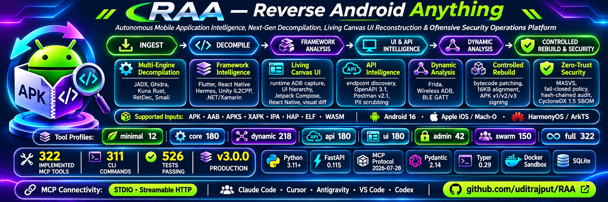
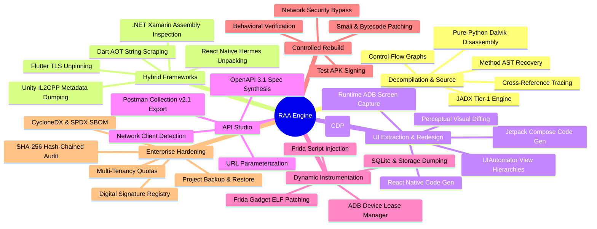
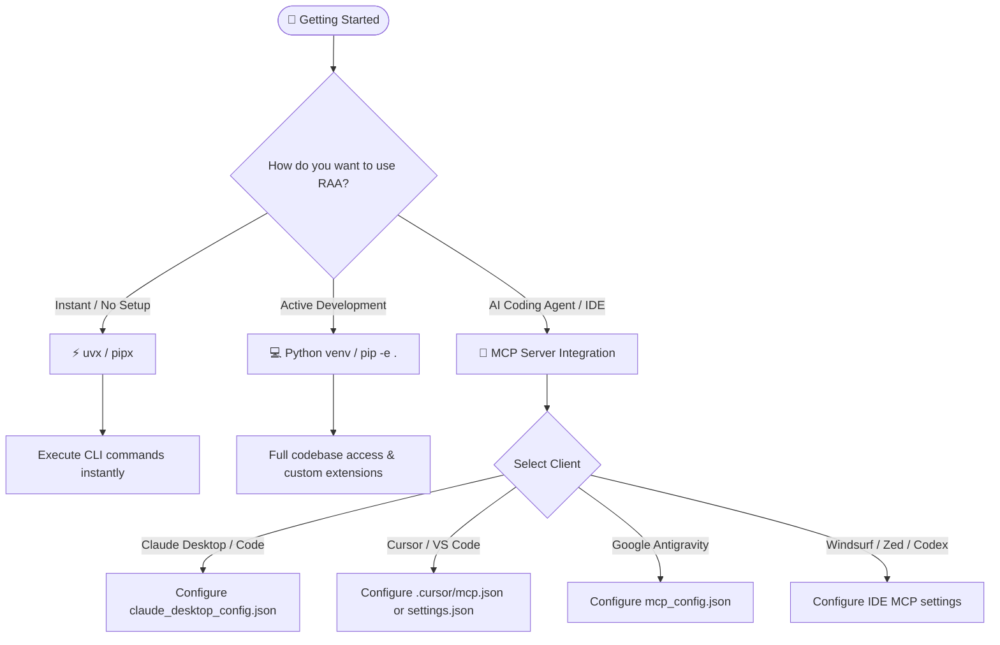
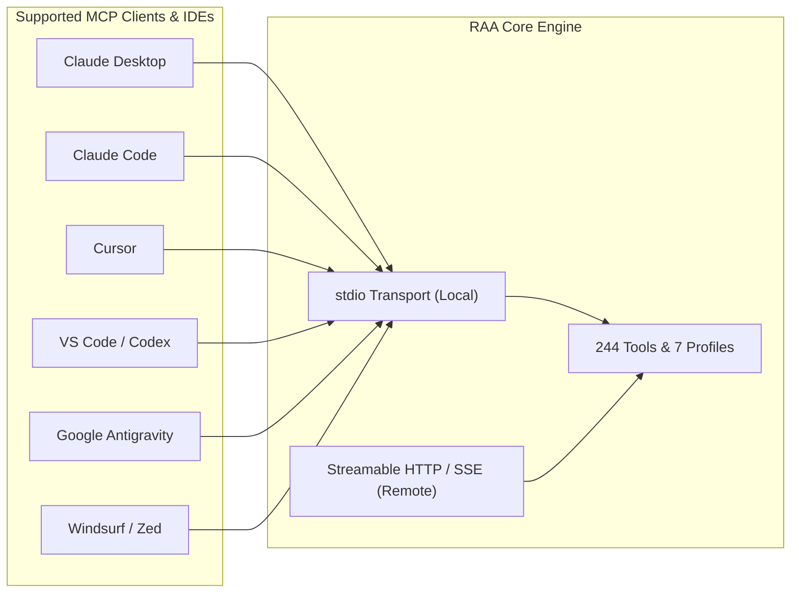
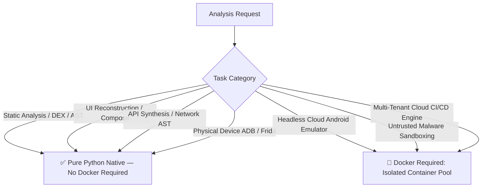

<h1 align="center">RAA — Reverse Android Anything</h1>

<p align="center">
  <strong>Agent-Native Multi-Platform Application Intelligence, Decompilation, UI Reconstruction & Security Engineering Platform</strong>
</p>

<p align="center">
  
</p>

<p align="center">
  
  
  
</p>
<p align="center">
  
  
</p>

<p align="center">
  <a href="https://fastapi.tiangolo.com"></a>
  <a href="https://www.python.org"></a>
  <a href="https://modelcontextprotocol.io"></a>
  <a href="https://docs.pydantic.dev"></a>
  <a href="https://typer.tiangolo.com"></a>
  <a href="https://www.docker.com"></a>
</p>
<p align="center">
  <a href="https://www.sqlite.org"></a>
  <a href="https://developer.android.com"></a>
  <a href="https://developer.apple.com/ios/"></a>
  <a href="https://developer.harmonyos.com"></a>
  <a href="https://www.uvicorn.org"></a>
</p>

---

## Overview

**RAA (Reverse Android Anything)** is a comprehensive, evidence-first Android reverse-engineering and application intelligence platform. It does not merely decompile APK files: it understands how an Android application is structured, how its Dalvik/native code executes, how its network APIs and databases interact, how its UI is composed, and how its original interface can be reconstructed and redesigned into modern frameworks.

> [!CAUTION]
> **LEGAL DISCLAIMER & LIMITATION OF LIABILITY — PLEASE READ BEFORE USE**
>
> **The developers, creators, maintainers, and contributors of RAA accept NO legal responsibility or liability of any kind for any damages, legal actions, criminal or civil liabilities, service disruptions, or copyright/intellectual property infringements resulting from the use or misuse of this software.**
>
> **The end-user is exclusively liable and bears 100% legal responsibility for all actions performed with RAA. You must independently verify and ensure full compliance with all applicable local, national, and international laws, regulations, terms of service, and authorization requirements before inspecting, decompiling, analyzing, modifying, or intercepting any application or device.**

RAA ingests **APK**, **AAB** (Android App Bundle), **APKS**, and **XAPK** archives, inventories their contents, detects frameworks and commercial packers, extracts view hierarchies and API contracts, and returns evidence-backed findings.

It is architected as **one unified analysis core** exposed simultaneously across:
- **Model Context Protocol (MCP):** Dynamic stdio and Streamable HTTP servers for AI coding agents (Claude Code, Cursor, Antigravity, VS Code, Codex).
- **REST Surface:** High-throughput FastAPI application with production security headers and OpenAPI 3.1 specifications.
- **Native CLI:** Command-line tool suite built with Typer and Rich for CI/CD automation and terminal analyst workflows.
- **Python SDK:** Direct programmatic library API.
- **Agent Skills:** 11 versioned prompt-based workflows in `skills/`.

---

## Key Documentation

- 📚 **[Documentation Hub](docs/README.md):** Complete navigation guide and documentation index.
- 🏛️ **[System Architecture](docs/ARCHITECTURE.md):** Architectural principles, subsystem topology, runtime flow, and multi-agent coordination.
- 🎨 **[System Design & Specification](docs/DESIGN.md):** Evidence-first truth model, fail-closed policy, 8pt UI design system, and API studio design.
- 🤖 **[Specialized Agents & Skills](docs/AGENTS_AND_SKILLS.md):** Multi-agent orchestration, specialized subagent fleet (41 roles), and 11 discoverable skills.
- 🚀 **[Strategic Roadmap](docs/ROADMAP.md):** Upcoming feature highlights and planned capability milestones across future releases.
- 🏢 **[Enterprise Deployment Guide](docs/DEPLOYMENT.md):** Production hardening, multi-tenancy quotas, air-gapped installation, and disaster recovery.
- 🔒 **[Security Architecture & Threat Model](docs/SECURITY.md):** Threat model, fail-closed scopes, tamper-evident audit logs, and OWASP MASTG compliance.
- 📦 **[Release History & Changelog](RELEASES.md):** Detailed version history and progression from Phase 1 to Phase 14 (v2.0.0 Production).

---

## Core Capabilities



---

## Tool Registry (244 Implemented Tools)

RAA organizes its 244 tools into 7 distinct capability profiles:

| Profile | Tool Count | Primary Use Case |
| :--- | :---: | :--- |
| **`minimal`** | **12** | Lightweight triage, manifest inspection, and basic artifact ingestion for small local LLMs. |
| **`core`** | **135** | Default static analysis, on-device PRoot mobile workspace harness, search-first MCP capability index, WASM binary decompiler, on-device AI reverser, Exploit PoC validator, MASVS checklist copilot, developer email OSINT footprint, class search, resource decoding. |
| **`dynamic`** | **169** | Core tools + Headless VirtualDisplay runner, multimodal mobile GUI agent crawler, visual grounding touch navigation, Burp Suite MCP bridge, P2P encrypted device tunnel, passive traffic inspector, and Wireless ADB fleet discoverer. |
| **`api`** | **139** | Core tools + Cloud rotating gateway proxy, Burp Suite MCP bridge, passive traffic inspector with PII redaction, nomore403 bypass engine, CrowdSec CTI reputation check, SafeLine semantic WAF audit, and OpenAPI synthesis. |
| **`ui`** | **140** | Core tools + Multimodal mobile GUI agent crawler, visual grounding touch navigation, Semantic Compose modernization, layout parity diff, Adaptive Icon Studio, banner generator, and AX-tree pruner. |
| **`admin`** | **19** | Zero-trust remote MCP gateway configurator, Bug Bounty report & VRT formatter, engine verification, tamper-evident audit verification, SBOM generation, disaster recovery, and telemetry. |
| **`full`** | **244** | Complete, unrestricted superset of all registered capabilities. |

---

## Specialized AI Agents & Skills

RAA coordinates 8 specialized AI agents via the **Coverage Tracker Service** (`agent_coverage_get`), supported by 11 discoverable skills in `skills/`:

```
skills/
├── raa-apk-triage/          # Manifest, permissions, framework and entry activity triage
├── raa-source-reconstruct/  # Decompilation, method call graphs, and AST recovery
├── raa-ui-redesign/         # View hierarchies, runtime capture, and 8pt Compose redesign
├── raa-api-discovery/       # Endpoint clustering, OpenAPI synthesis, and Postman export
├── raa-flutter-reversing/   # Flutter BoringSSL TLS unpinning and Dart string scraping
├── raa-native-reversing/    # JNI function mapping, dynamic symbols, and C/C++ disassembly
├── raa-security-audit/      # MASVS compliance, secret scanning, and privacy data flows
├── raa-controlled-rebuild/  # APK patching, gadget injection, signing, and ADB installation
├── android-triage/          # Fast single-pass APK triage workflow
├── platform-check/          # Host environment, dependencies, and sidecar diagnostics
└── report-and-export/       # Executive Markdown, JSON, and PDF report generation
```

---

## Installation & Configuration

RAA can be deployed in seconds across any environment — from zero-install CLI execution to full IDE AI agent integration.

### Quick Decision Matrix



---

### 1. Installation Options

<details open>
<summary><strong>⚡ Option A: Instant Zero-Install (Recommended for Quick Runs)</strong></summary>

Execute RAA commands immediately without manually managing Python virtual environments:

```bash
# Using Astral uvx (sub-second execution):
uvx --from . raa --help

# Or via PyPA pipx:
pipx run --spec . raa --help
```

</details>

<details>
<summary><strong>💻 Option B: Local Developer Virtual Environment (Recommended for Contributors)</strong></summary>

```bash
# 1. Clone repository & enter workspace
git clone <repository-url>
cd RAA

# 2. Create and activate virtual environment
python -m venv .venv

# On Windows (PowerShell):
.\.venv\Scripts\Activate.ps1
# On Linux / macOS:
source .venv/bin/activate

# 3. Install in editable mode with development dependencies
pip install -e ".[dev]"

# 4. Verify installation
raa --version
```

</details>

<details>
<summary><strong>📦 Option C: Global Tool Installation</strong></summary>

```bash
# Install as a permanent isolated system tool
uv tool install .
# Or via pipx:
pipx install .
```

</details>

---

### 2. Workspace & Environment Configuration

Initialize the local analysis workspace and configure runtime parameters:

```bash
# Initialize local SQLite workspace (defaults to .raa-workspace/)
raa init

# Copy example environment configuration
cp .env.example .env
```

<details>
<summary><strong>⚙️ Key Environment Variables (Click to expand)</strong></summary>

| Variable | Default | Purpose & Description |
| :--- | :---: | :--- |
| `RAA_WORKSPACE` | `.raa-workspace` | Directory for SQLite DB, evidence, cached DEX, and artifacts. |
| `RAA_PROFILE` | `core` | Active MCP profile (`minimal`, `core`, `dynamic`, `api`, `ui`, `admin`, `full`). |
| `RAA_LOG_LEVEL` | `INFO` | Logging verbosity (`DEBUG`, `INFO`, `WARNING`, `ERROR`). |
| `RAA_LOG_JSON` | `false` | When `true`, outputs JSON logs for observability pipelines. |
| `RAA_API_HOST` | `127.0.0.1` | Bind address for REST API and Streamable HTTP MCP server. |
| `RAA_API_PORT` | `8765` | Network port for HTTP/SSE services. |
| `RAA_API_TOKEN` | *(None)* | Bearer authentication token for securing REST and remote MCP access. |
| `RAA_MAX_INPUT_BYTES` | `2147483648` | Maximum artifact upload/ingest size in bytes (default: 2 GB). |

</details>

---

### 3. AI Coding Agent & IDE MCP Integrations

RAA communicates with all major AI coding environments via the **Model Context Protocol (Protocol 2026-07-28)** using standard I/O (`stdio`) or Streamable HTTP (`SSE`).



#### Automated Setup (One-Click)

Generate configuration automatically for your preferred AI client:

```bash
# Claude Desktop
raa setup --agent claude-desktop

# Cursor
raa setup --agent cursor

# Claude Code
raa setup --agent claude-code

# VS Code / Codex
raa setup --agent vscode
```

#### Manual IDE Configuration Snippets

<details>
<summary><strong>🟣 Claude Desktop</strong> (<code>claude_desktop_config.json</code>)</summary>

*Path:* `%APPDATA%\Claude\claude_desktop_config.json` (Windows) or `~/Library/Application Support/Claude/claude_desktop_config.json` (macOS)

```json
{
  "mcpServers": {
    "raa": {
      "command": "python",
      "args": ["-m", "raa.cli.main", "--workspace", ".raa-workspace", "--profile", "full", "serve", "mcp"]
    }
  }
}
```

</details>

<details>
<summary><strong>⚡ Cursor</strong> (<code>.cursor/mcp.json</code>)</summary>

*Path:* Project root `.cursor/mcp.json` or Cursor Global Settings:

```json
{
  "mcpServers": {
    "raa": {
      "command": "python",
      "args": ["-m", "raa.cli.main", "--workspace", ".raa-workspace", "--profile", "core", "serve", "mcp"]
    }
  }
}
```

</details>

<details>
<summary><strong>🪐 Google Antigravity IDE</strong> (<code>mcp_config.json</code>)</summary>

*Path:* Global `%USERPROFILE%\.gemini\config\mcp_config.json` or Workspace `.agents/mcp_config.json`:

```json
{
  "mcpServers": {
    "raa": {
      "command": "python",
      "args": ["-m", "raa.cli.main", "--workspace", ".raa-workspace", "--profile", "full", "serve", "mcp"],
      "env": {
        "RAA_LOG_LEVEL": "INFO"
      }
    }
  }
}
```

</details>

<details>
<summary><strong>🔷 VS Code & GitHub Copilot / Codex</strong></summary>

*Path:* `.vscode/settings.json` or User Settings:

```json
{
  "mcp.servers": {
    "raa": {
      "command": "python",
      "args": ["-m", "raa.cli.main", "--workspace", ".raa-workspace", "--profile", "core", "serve", "mcp"]
    }
  }
}
```

</details>

<details>
<summary><strong>🌊 Windsurf & Zed Editor</strong></summary>

*Path:* `~/.codeium/windsurf/mcp_config.json` or Zed `settings.json`:

```json
{
  "mcpServers": {
    "raa": {
      "command": "python",
      "args": ["-m", "raa.cli.main", "--profile", "core", "serve", "mcp"]
    }
  }
}
```

</details>

<details>
<summary><strong>🌐 Remote / Streamable HTTP Server (SSE)</strong></summary>

For shared servers, remote containers, or web-based AI clients:

```bash
# Start RAA MCP in Streamable HTTP / SSE mode:
raa serve mcp --transport sse --host 0.0.0.0 --port 8765
```

Connect using standard SSE URL: `http://<server-ip>:8765/sse`

</details>

---

### 4. 🐳 When is Docker Required?

> [!NOTE]
> **Docker is 100% OPTIONAL for typical RAA workflows.** All 244 core static analysis, decompilation, UI reconstruction, and API synthesis tools run in pure Python without Docker.



Docker is **strictly required only** in the following 3 conditions:

| Scenario | Condition | Docker Tool / Image |
| :---: | :--- | :--- |
| **1** | **Headless Virtual Android Emulators** | When running dynamic tests without physical Android hardware connected (`docker_android_run`, using `budtmo/docker-android` or `redroid/redroid`). |
| **2** | **Untrusted Malware Sandboxing** | When executing untrusted binary payloads or aggressive runtime hooking in an isolated sandbox (`docker_sandbox_exec`). |
| **3** | **Cloud Multi-Tenant CI/CD Fleets** | When running RAA inside enterprise Kubernetes or containerized microservices to guarantee zero-residue workspace isolation. |

---

### 5. Starting Services & Health Verification

```bash
# 1. Verify environment, sidecars, and dependencies
raa doctor

# 2. Start REST API (Swagger UI at http://127.0.0.1:8765/docs)
raa serve api --host 127.0.0.1 --port 8765

# 3. Start interactive MCP server (stdio)
raa serve mcp
```

---

## Quick Start: CLI Workflows

```powershell
# Ingest an APK and create a project
raa project create "My Analysis Project"
raa artifact ingest prj_xxx /path/to/target.apk

# Inspect Manifest & Decompile
raa manifest inspect prj_xxx art_xxx
raa source search prj_xxx "AuthToken"

# Synthesize OpenAPI 3.1 Specification and Export Postman Collection
raa api synthesize prj_xxx art_xxx
raa api postman prj_xxx art_xxx --output ./postman_collection.json

# Extract UI, Capture Runtime Screen & Generate Jetpack Compose Redesign
raa ui tree prj_xxx art_xxx
raa ui redesign prj_xxx screen_main --framework compose

# Verify Tamper-Evident Audit Trail & Generate CycloneDX SBOM
raa admin audit-verify
raa admin sbom --format cyclonedx

# Backup Project for Disaster Recovery
raa admin backup prj_xxx --output ./backup.raa.bundle.tar.gz
```

---

---

## Frequently Asked Questions (Q&A)

<details>
<summary><strong>1. Who is legally responsible for using RAA to analyze applications?</strong></summary>
<br>

**The end-user bears 100% sole legal liability.** The developers, authors, maintainers, and contributors of RAA accept no responsibility, obligation, or liability of any kind for any legal consequences, damages, civil suits, regulatory penalties, or criminal charges arising from your use or misuse of this tool. You must ensure you have explicit written authorization before analyzing, decompiling, or intercepting any target software or hardware.

</details>

<details>
<summary><strong>2. What platforms, package formats, and architectures does RAA support?</strong></summary>
<br>

RAA is a universal application reversing platform supporting:
- **Android:** APK, Android App Bundle (AAB), split APK sets (APKS), and XAPK archives across ARM64, ARMv7, x86, and x86_64.
- **Apple iOS:** Application containers (`.ipa`), 64-bit Mach-O binaries, FairPlay DRM audit (`cryptid`), Info.plist permissions, and PKCS#7 signed embedded provisioning profiles.
- **Huawei HarmonyOS & OpenHarmony:** `.hap` packages, Stage (`module.json`) and FA (`config.json`) application models, and ArkTS Panda ABC bytecode (`classes.abc`).

</details>

<details>
<summary><strong>3. How does RAA connect with AI Coding Agents (Claude Code, Cursor, Antigravity, VS Code)?</strong></summary>
<br>

RAA natively implements the **Model Context Protocol (MCP)** specification. You can run RAA as a local MCP server over standard input/output (`stdio`) or as a networked background server over Streamable HTTP (`FastMCP`). AI agents discover all 244 registered tools with their complete JSON Schema inputs and execute end-to-end reversing, security audits, and UI reconstruction autonomously.

</details>

<details>
<summary><strong>4. Can RAA be used completely offline in air-gapped secure labs?</strong></summary>
<br>

**Yes, absolutely.** RAA is engineered with a strict local-first, zero-egress architecture. All core analysis routines, Dalvik/DEX parsing, Mach-O inspection, and ABC bytecode disassembly are written in pure Python with zero external network dependencies. No telemetry or data is ever transmitted outside your local machine.

</details>

<details>
<summary><strong>5. How does RAA prevent unauthorized or accidental modifications to devices?</strong></summary>
<br>

RAA enforces a **fail-closed security policy engine**. Potentially hazardous operations (such as binary patching, code injection, or device mutation) require explicit project-level scope grants (e.g., `android.patch`, `dynamic.hook`, `dynamic.device`). Any operation lacking the authorized scopes fails closed with a `PolicyDeniedError` before execution. In addition, all tool invocations are permanently cryptographically recorded in an append-only, hash-chained audit log.

</details>

<details>
<summary><strong>6. What are the 7 capability profiles and what tools do they expose?</strong></summary>
<br>

RAA uses capability profiles to tailor tool exposure to specific agents and contexts:
- <code>minimal</code> (12 tools): Essential triage and summary tools for lightweight models.
- <code>core</code> (135 tools): Static analysis, source inspection, frameworks, and decompilation.
- <code>dynamic</code> (169 tools): Runtime ADB, Frida instrumentation, and network interception.
- <code>api</code> (139 tools): API reverse-engineering, spec synthesis, and threat intelligence.
- <code>ui</code> (140 tools): View hierarchy extraction, visual grounding, and UI code generation.
- <code>admin</code> (19 tools): Cryptographic audit verification, doctor, SBOM, and licensing.
- <code>full</code> (244 tools): Complete, unrestricted tool catalog for frontier models.

</details>

<details>
<summary><strong>7. Does RAA require root access on connected Android devices?</strong></summary>
<br>

**No, root is not mandatory.** While rooted devices unlock full kernel tracing and raw socket capture, RAA supports non-rooted workflows using:
- Privileged operations via the **Shizuku IPC Bridge** (<code>shizuku_privileged_exec</code>).
- Standalone userspace Linux containers via **Termux PRoot** (<code>termux_proot_workspace_manage</code>).
- Virtual headless fuzzing via **VirtualDisplay** and **Docker-Android** emulators.

</details>

<details>
<summary><strong>8. How does the UI Reconstruction engine generate code from screenshots?</strong></summary>
<br>

RAA extracts runtime view hierarchies via ADB or Chrome DevTools Protocol (CDP), prunes the accessibility tree (AX-tree), clusters styling properties (typography, paddings, colors) against an 8pt design system, and synthesizes production-ready **Jetpack Compose** (Android) or **React Native** code with perceptual visual diff verification.

</details>

---

## Verification & Quality Gates

RAA maintains 100% test pass rates and strict zero-lint compliance:

```powershell
# Run the complete test suite (437 tests)
python -m pytest -v

# Run linting and style checks
python -m ruff check src tests
python -m ruff format --check src tests
```

---

## License & Legal Disclaimer

### Limitation of Liability & User Responsibility

> [!WARNING]
> **IMPORTANT LEGAL NOTICE: USER ASSUMES ALL LIABILITY**
>
> 1. **No Developer Responsibility:** The authors, maintainers, and contributors of **RAA (Reverse Android Anything)** provide this software "AS IS" without warranty of any kind. Under no circumstances shall the developers be held liable for any direct, indirect, incidental, special, exemplary, or consequential damages, or any legal liabilities, civil claims, regulatory penalties, or criminal prosecutions arising from the use or misuse of this software.
> 2. **Sole End-User Liability:** **The user bears 100% sole legal liability and responsibility** for all reverse-engineering, dynamic instrumentation, traffic analysis, decompilation, and testing activities conducted using RAA. Users must independently ensure that all actions comply strictly with all applicable local, national, and international laws, regulations, intellectual property protections, contracts, and software licenses (such as the DMCA, CFAA, and EU Computer Misuse directives).
> 3. **Authorized Use Only:** RAA is intended exclusively for authorized security audits, academic research, and defensive evaluation of applications owned by the user or where explicit, written authorization has been granted by the rightful owner.
>
> For full security and compliance policies, refer to [SECURITY.md](docs/SECURITY.md).

### License

This project is licensed under the **MIT License**. See the [LICENSE](LICENSE) file for complete details.
