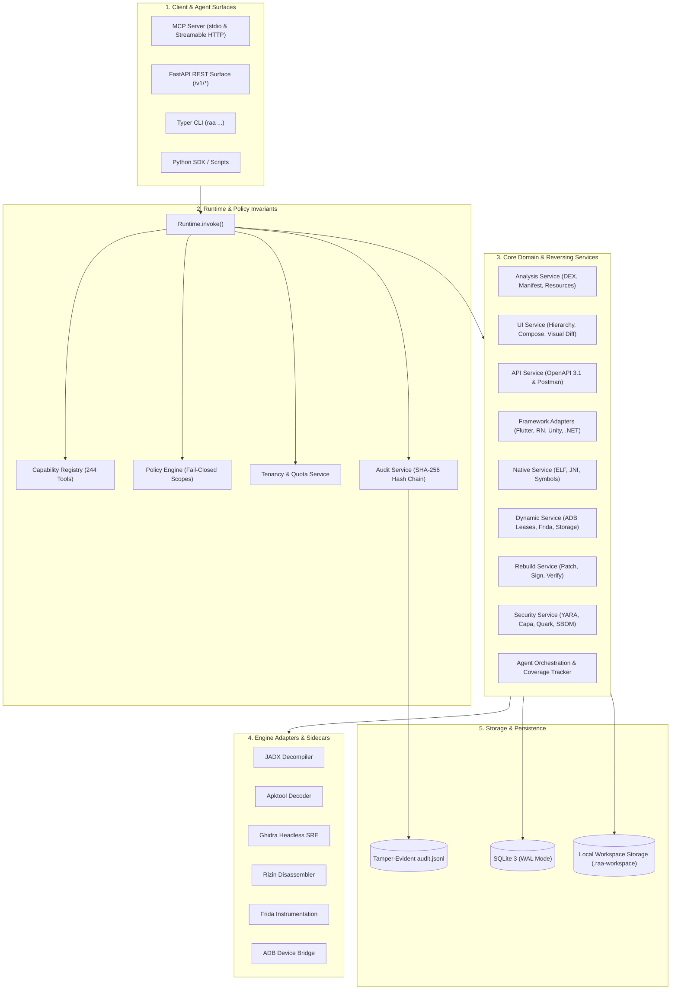
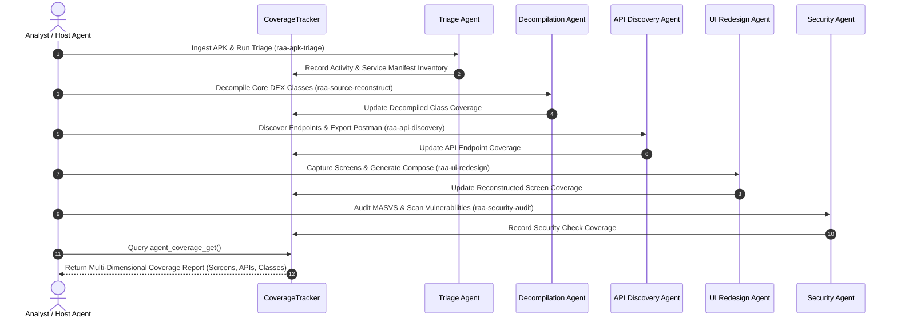

# RAA System Architecture

  

  
  
  

  
  

This document details the software architecture, runtime topology, data flow, component interfaces, and subsystem orchestration of **RAA (Reverse Android Anything)**.

---

## 1. Architectural Principles

1. **One Analysis Core, Multiple Surfaces:** RAA does not maintain separate business logic for CLI, REST, MCP, or Python SDK. Every surface delegates directly to `Runtime.invoke(tool_name, arguments)`. Tool schemas, argument validation, policy enforcement, evidence recording, and audit trails behave identically everywhere.
2. **Evidence-First Truth Hierarchy:** Material analysis results are backed by immutable `Evidence` records. Data is strictly separated into **Observations** (direct bytes/tokens), **Derivations** (synthesised AST/graphs), and **Inferences** (heuristic/AI predictions). Inferences are never disguised as original source.
3. **Fail-Closed Policy Engine:** All operations that mutate containers (`android.patch`, `android.sign`), lease hardware devices (`dynamic.device`), inject code (`dynamic.hook`), or write exports (`export.write`) require explicit project scope grants. Denials fail closed before handler invocation.
4. **Local-First & Zero Egress:** State lives within the `.raa-workspace` directory and a local SQLite3 database (WAL mode). No network telemetry, cloud dependencies, or unprompted network egress exist in the analyzer.
5. **Multi-Agent Orchestration via Coverage Tracking:** Dedicated AI agents operate with least-privilege tool access, coordinated through a centralized `CoverageTracker` that tracks audited activities, APIs, native binaries, and UI screens.

---

## 2. High-Level Component Topology

---

## 3. Subsystem Breakdown

### 3.1 Multi-Surface Dispatch (`Runtime.invoke`)
All client interactions flow through `Runtime.invoke()` in `src/raa/runtime.py`:
1. **Tool Discovery:** Verifies tool existence in `CapabilityRegistry`.
2. **Profile Gating:** Ensures the tool is permitted in the selected profile (`minimal`, `core`, `dynamic`, `api`, `ui`, `admin`, `full`).
3. **Pydantic Validation:** Validates input arguments against `ToolSpec.input_model`.
4. **Policy Evaluation:** Compares required scopes (`spec.scopes`) against the project's granted scopes via `PolicyEngine.evaluate()`.
5. **Execution & Context Injection:** Constructs an immutable `ToolContext` and awaits `spec.handler(context, parsed_args)`.
6. **Result Envelope:** Wraps outcome into a standardized `ToolEnvelope` containing `data`, `evidence_ids`, `warnings`, and `meta` (duration, tool count, protocol version).
7. **Audit Trail Recording:** Appends invocation metadata, request ID, and canonical argument hash into the SHA-256 hash-chained log.

### 3.2 Registry and Profile Architecture
RAA organizes its 151 tools into 7 hierarchical profiles defined in `src/raa/registry/profiles.py`:
- `minimal` (12 tools): Essential triage, manifest inspection, and basic artifact ingestion.
- `core` (94 tools): Standard static analysis, class/resource search, and diagnostics.
- `dynamic` (110 tools): Extends `core` with ADB device leasing, Frida gadget injection, and memory dumping.
- `api` (111 tools): Extends `core` with API endpoint harvesting, OpenAPI 3.1 synthesis, and Postman export.
- `ui` (110 tools): Extends `core` with view hierarchy parsing, Jetpack Compose trees, runtime capture, and 8pt redesign synthesis.
- `admin` (14 tools): Engine verification, cryptographic audit verification, SBOM generation, disaster recovery backup/restore, and telemetry.
- `full` (151 tools): The superset of all registered capabilities.

### 3.3 Hybrid UI Extraction & Redesign Engine
The UI pipeline follows a 7-stage hybrid clean-room workflow:
1. **Runtime Screen Capture:** Captures emulator/device screenshots via ADB.
2. **View Hierarchy Extraction:** Dumps runtime accessibility hierarchies (`uiautomator dump`) and inspects WebViews via Chrome DevTools Protocol (CDP).
3. **Static XML Layout & Compose AST Parsing:** Resolves XML layout references, `@dimen` measurements, and Compose `@Composable` call trees.
4. **Design Token Synthesis:** Maps raw colors and measurements into a structured design system (strict 8-point spatial grid, thumb-zone CTA positioning, 60/30/10 color dominance).
5. **Multi-Framework Code Generation:** Generates production-ready frontend code (Jetpack Compose, React Native, Flutter, Tailwind HTML).
6. **Visual Diffing:** Computes perceptual structural diffs comparing the redesigned screen against original screenshots.

### 3.4 API Reverse Engineering Studio
`ApiService` extracts hardcoded URLs, detects networking clients (OkHttp, Retrofit, Ktor, Volley), clusters observed endpoints into parameterized paths (`/api/v1/users/{id}`), infers request/response schemas, and produces:
- OpenAPI 3.1 JSON/YAML specifications.
- Runnable Postman Collection v2.1 suites with automated environment variables.

### 3.5 Framework Reversing Adapters
- **Flutter & Dart:** Analyzes `libflutter.so` and `libapp.so`, patches BoringSSL TLS verification offsets for universal proxying, and scrapes Dart snapshot string pools.
- **React Native:** Unpacks Hermes bytecode (`index.android.bundle`), extracts source maps, and inventories registered native modules.
- **Unity & .NET:** Parses `global-metadata.dat`, extracts string literals, and coordinates with `Il2CppDumper` to recover C# class prototypes and struct layouts from `libil2cpp.so`.

### 3.6 Native Binary & JNI Analysis
`NativeService` performs dependency-free ELF parsing on native shared objects (`.so`) across `arm64-v8a`, `armeabi-v7a`, `x86`, and `x86_64`:
- Resolves ELF program headers, dynamic symbols, and exported functions.
- Discovers JNI bridge registrations (`Java_com_example_MainActivity_nativeMethod` and runtime `RegisterNatives` calls).
- Coordinates with headless Ghidra and Rizin sidecars for deep C/C++ disassembly.

---

## 4. Multi-Agent Orchestration & Coverage

RAA coordinates multi-agent reverse-engineering teams using specialized roles and an integrated `CoverageTracker` service:

---

## 5. Security Architecture & Data Provenance

1. **Hash-Chained Audit Trail:** Every tool execution writes to `.raa-workspace/audit/audit.jsonl` with SHA-256 hash chaining ($\text{hash}_n = \text{SHA-256}(\text{hash}_{n-1} \parallel ":" \parallel \text{canonical\_entry})$). Integrity is verified via `admin_audit_verify`.
2. **Digital Signatures:** Skills and recipes are signed and verified with HMAC-SHA256 or detached `.sig` files (`admin_signature_verify`).
3. **Multi-Tenancy & Quotas:** Project counts, storage bytes, and concurrent background jobs are strictly capped per tenant via `TenancyService`.
4. **Data Provenance:** Every evidence item tracks its `authority` (`OBSERVED_BYTECODE`, `DERIVED_AST`, `ANALYST_INFERENCE`), `confidence` (0.0 to 1.0), and source artifact hash.
