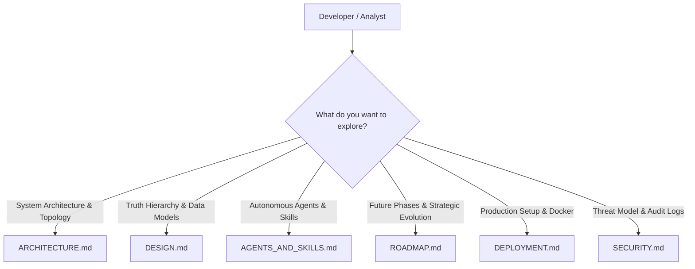

# RAA Documentation Hub

  

  
  
  

  
  

Welcome to the **RAA (Reverse Android Anything)** official documentation index. RAA is an agent-native application intelligence, decompilation, UI reconstruction, and security engineering platform covering Android (APK/AAB), Apple iOS (IPA/Mach-O), Huawei HarmonyOS (HAP/ArkTS), and on-device Linux containers (PRoot/Termux).

---

## Documentation Index

| Document | Focus & Highlights | Intended Audience |
| :--- | :--- | :--- |
| 🏛️ **[`ARCHITECTURE.md`](ARCHITECTURE.md)** | Subsystem topology, single-core runtime invariants, component interfaces, and multi-platform engine adapters. | Architects, Core Contributors, Integrators |
| 🎨 **[`DESIGN.md`](DESIGN.md)** | Evidence-first truth hierarchy, domain entities, 8pt UI design system, and Model Context Protocol (MCP) contracts. | System Engineers, UI Designers, Agent Authors |
| 🤖 **[`AGENTS_AND_SKILLS.md`](AGENTS_AND_SKILLS.md)** | Multi-agent orchestration, specialized subagent fleet (41 roles), and 11 discoverable Agent Skills. | AI Researchers, Prompt Engineers, Swarm Operators |
| 🚀 **[`ROADMAP.md`](ROADMAP.md)** | Strategic platform roadmap and upcoming feature highlights across future releases. | Developers, Architects, Contributors |
| 🏢 **[`DEPLOYMENT.md`](DEPLOYMENT.md)** | Enterprise production deployment, Docker sandboxing, multi-tenancy quotas, air-gapped installation, and disaster recovery. | DevOps, SREs, Enterprise System Administrators |
| 🔒 **[`SECURITY.md`](SECURITY.md)** | STRIDE threat model, fail-closed policy engine, SHA-256 hash-chained audit trails, and OWASP MASTG compliance. | Security Auditors, Compliance Officers, Penetration Testers |

---

## Quick Navigation by Role

---

## Key Platform Specifications

- **Active Version:** `v2.0.0 Production` (Phase 14 Complete)
- **Implemented Capability Tools:** `244` tools registered and tested
- **Passing Test Suite:** `437` automated unit, integration, and E2E tests
- **MCP Protocol Baseline:** `2026-07-28`
- **Supported Application Formats:**
  - **Android:** `.apk`, `.aab`, `.apks`, `.xapk` (Dalvik `.dex`, AXML, ARSC, ELF `.so`)
  - **Apple iOS:** `.ipa` (Mach-O 64-bit, Objective-C, Swift metadata)
  - **Huawei HarmonyOS:** `.hap` (ArkTS Panda `.abc` bytecode, module.json)
  - **On-Device Linux:** PRoot/Termux standalone rootless container engine
