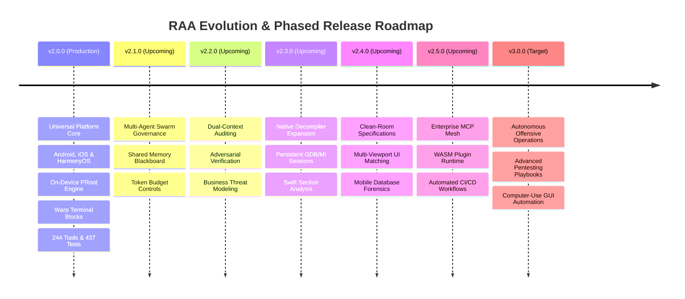

# RAA Strategic Roadmap

  

  
  
  
  

  
  

This document outlines the high-level roadmap and upcoming feature tracks planned for future releases of **RAA (Reverse Android Anything)**.

---

## 1. Executive Roadmap Overview

RAA v2.0.0 delivers a complete, production-grade application intelligence, decompilation, UI reconstruction, and security platform covering Android, iOS, HarmonyOS, and on-device Linux containers.

Future releases will evolve the platform towards autonomous multi-agent swarm orchestration, advanced native decompilation bridges, clean-room application reconstruction, and enterprise ecosystem integrations.

---

## 2. Upcoming Features by Release

### v2.1.0 — Autonomous Swarm Governance & Shared Memory
- **Hierarchical Swarm Orchestration:** Multi-agent role coordination and reporting trees for complex, long-running audits.
- **Shared Knowledge Blackboard:** Inter-agent messaging and state sharing with cryptographic evidence tagging.
- **Strict Budget & Token Metering:** Granular spend limits, session timeouts, and execution controls per project and agent.

### v2.2.0 — Dual-Context Auditing & Economic Impact Modeling
- **Zero-Context Adversarial Review:** Independent validation passes to eliminate AI confirmation bias on detected vulnerabilities.
- **Economic Attacker Modeling:** Quantitative threat assessment estimating attack viability and business risk.
- **In-App Purchase & Billing Analysis:** Static heuristics for evaluating client-side payment workflows and receipt integrity.

### v2.3.0 — Native Decompiler Expansion & Debugger Sessions
- **Interactive Debugger State Machine:** Support for persistent GDB/MI and LLDB command sessions inside virtual environments.
- **Deep Objdump & DWARF Parsing:** Inspection of native symbol tables, relocations, and debug links without context window bloat.
- **Enhanced Native Binary Analysis:** Integrated bridges for external disassemblers and headless analysis workflows.
- **IoT Companion Firmware Extraction:** Detection and extraction of embedded firmware partitions in mobile companion apps.

### v2.4.0 — Clean-Room Specifications & UI Reconstruction
- **Clean-Room Functional Specification Synthesis:** Automated generation of abstract, copyright-clean functional specifications.
- **Multi-Viewport UI Verification:** Automated visual and AST layout comparisons across compact phone, foldable, and tablet form factors.
- **Design Token & Palette Extraction:** Automated recovery of typography scales, spacing tokens, and color palettes into standard formats.
- **Mobile Game & Asset Unpackers:** Extraction of game archives, serialized assets, and embedded scene trees.
- **Mobile Database Forensics:** In-depth inspection and recovery tools for mobile SQLite, Room, Realm, and encrypted databases.

### v2.5.0 — Enterprise Ecosystem & Extensibility
- **WebAssembly (WASM) Tool Sandbox:** Isolated runtime environment for custom, capability-gated analyst plugins.
- **Enterprise MCP Mesh Integration:** Interoperability with external test management, code repository, and browser automation MCP servers.
- **Universal Multi-Harness Compatibility:** Standardized execution adapter across leading terminal coding agents and AI CLIs.
- **Cryptographic Mutation Guardrails:** Automated pre- and post-operation integrity verification ensuring zero binary corruption.

### v3.0.0 — Offensive Operations & Autonomous Validation
- **Automated Pentesting Playbooks:** Comprehensive verification workflows for access control bypasses, path traversal, and endpoint fuzzing.
- **Autonomous GUI Automation:** Visual grounding and interaction capabilities for operating desktop reverse-engineering software.
- **Standardized Skill Benchmarking:** Automated regression and accuracy evaluation framework for AI agent capabilities.

---

## 3. High-Level Release Matrix

| Release | Focus Area | Key Highlights | Status |
| :--- | :--- | :--- | :---: |
| **v2.0.0** | Universal Platform Expansion | Android APK/AAB, Apple iOS IPA, HarmonyOS HAP, PRoot Linux, Warp Blocks. | **Delivered (Production)** |
| **v2.1.0** | Swarm Governance & Memory | Multi-agent coordination, shared blackboard, token budgeting. | In Development |
| **v2.2.0** | Dual-Context & Threat Economics | Adversarial audit verification, economic exploit payoff modeling. | Planned |
| **v2.3.0** | Native Analysis & Debugging | Persistent GDB/MI sessions, DWARF link parsing, native bridges. | Planned |
| **v2.4.0** | Clean-Room & UI Reconstruction | Clean-room specs, multi-viewport UI verification, mobile DB forensics. | Planned |
| **v2.5.0** | Enterprise Mesh & Extensibility | WASM plugin sandbox, enterprise MCP mesh, mutation guardrails. | Planned |
| **v3.0.0** | Offensive Security & Validation | Automated pentest playbooks, autonomous GUI automation, skill benchmarks. | Target Release |

---

> [!NOTE]
> Specific delivery timelines and operational details are subject to internal prioritization and security review. For technical specifications on currently implemented capabilities, refer to [`ARCHITECTURE.md`](ARCHITECTURE.md) and [`DESIGN.md`](DESIGN.md).
