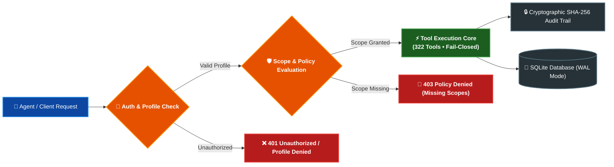

# RAA Security Architecture & Threat Model

  

  
  
  

  
  

This document details the security architecture, threat model, authorization controls, and cryptographic integrity mechanisms implemented across **RAA (Reverse Android Anything)**.

---

## 1. Security Architecture & Invariants

RAA operates as an evidence-first, security-hardened intelligence engine. Its design adheres to the principle of least privilege, strict separation of concerns, and fail-closed defaults.

### Threat Vectors & Mitigations

| Threat Vector | Severity | Mitigation Strategy |
| :--- | :---: | :--- |
| **Unauthorized Action Execution** | Critical | Fail-closed `PolicyEngine`. Mutating operations (`android.patch`, `dynamic.device`, `project.write`) require explicit project scope grants. |
| **Audit Log Tampering / Repudiation** | High | Append-only SHA-256 hash chaining. Modifying, deleting, or reordering an entry breaks the chain and is detected by `admin_audit_verify`. |
| **Secret / Credential Leakage in Logs** | High | Arguments are NEVER logged raw. Only argument keys and a canonical SHA-256 digest of input parameters are stored in the audit trail. |
| **Malicious Skill / Recipe Injection** | High | Detached cryptographic signatures (HMAC-SHA256 / Ed25519) verified via `admin_signature_verify`. Untrusted content is flagged as `tampered` or `unsigned`. |
| **Resource Exhaustion & Denial of Service** | Medium | Built-in `TenancyService` enforces project count limits, storage quotas, and concurrent job caps. |
| **Supply Chain Vulnerability** | Medium | Automated CycloneDX v1.5 and SPDX 2.3 SBOM generation with vulnerability scanning integration (`Syft`, `Grype`). |

---

## 2. Fail-Closed Scope System

Tools in RAA are classified by scopes and profile tiers. Every project is initialized with a safe baseline set of read-only scopes (`project.read`, `static.read`, `export.write`). Sensitive actions require explicit administrative authorization:

| Scope | Privilege Level | Protected Operations |
| :--- | :---: | :--- |
| `project.read` | Safe | Read project metadata, artifacts, and summary reports. |
| `project.write` | Moderate | Create, update, or archive projects and ingest artifacts. |
| `static.read` | Safe | Read decompiled DEX bytecode, XML layouts, and resources. |
| `dynamic.device` | Privileged | Connect to ADB devices, acquire device leases, and capture runtime screens. |
| `dynamic.hook` | Privileged | Deploy Frida scripts, attach to processes, and monitor API traffic. |
| `android.patch` | High | Inject Frida gadgets, rewrite Dalvik bytecode, and recompile APKs. |
| `export.write` | Safe | Export OpenAPI specifications, Postman collections, and wireframes. |

---

## 3. Cryptographic Verification & Tamper Resistance

### 3.1 Hash-Chained Audit Logs
The audit service (`src/raa/services/audit.py`) records all tool invocations with cryptographic linking:
- **Hash Algorithm:** SHA-256
- **Chain Invariant:** $\text{hash}_n = \text{SHA-256}(\text{hash}_{n-1} \parallel ":" \parallel \text{canonical\_entry}_n)$
- **Verification Tool:** `admin_audit_verify` (`raa admin audit-verify`) verifies the entire chain from line 1 to EOF.

### 3.2 Digital Signatures
The signing service (`src/raa/services/signing.py`) validates skills, recipes, and engine manifests:
- **Detached Signatures:** Stored in `.sig` companion files containing algorithm ID, timestamp, and signature hex.
- **Support:** HMAC-SHA256 for local deployments, Ed25519 for enterprise distribution.
- **Verification:** `admin_signature_verify` validates artifacts before execution.

---

## 4. OWASP MASTG & MAPT Compliance

RAA implements automated test procedures mapped directly to the **OWASP Mobile Application Security Verification Standard (MASVS)**:
- **MASVS-STORAGE:** Insecure data storage, SharedPreferences, SQLite unencrypted credentials.
- **MASVS-CRYPTO:** Weak cryptographic ciphers (ECB, DES, RC4), hardcoded static IVs, static salt reuse.
- **MASVS-AUTH:** Biometric bypass, lockscreen bypass heuristics, exported component access.
- **MASVS-NETWORK:** Cleartext traffic permission, weak TLS configurations, missing certificate pinning.
- **MASVS-PLATFORM:** Exported activities, services, broadcast receivers, and content providers without permission checks.
- **MASVS-CODE:** Obfuscation status, anti-debug/anti-tamper/RASP detection signatures.

---

## 5. Responsible Disclosure Policy

If you discover a security vulnerability in RAA itself, please report it via private security advisory on GitHub or email the maintainers directly. Do not open public GitHub issues for security vulnerabilities.
