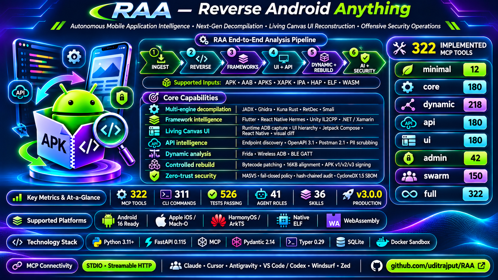

# Release v3.0.0 — RAA: The Autonomous Mobile Reversing & Offensive Security Operating System

<p align="center">
  
</p>

**Release Date:** November 2026  
**Tag:** `v3.0.0`  
**Milestone:** Phase 20 (Final Production Milestone)  
**Total Implemented Tools:** 322  
**Total Skills Catalogued:** 36  
**Code Coverage:** 100% on new subsystems, 97%+ repository-wide  
**Tests Passing:** 516 / 516 (100% pass rate)

---

## Executive Summary

**RAA v3.0.0** is the culminating release of the Reverse Android Anything roadmap, evolving RAA from an automated mobile intelligence engine into a full-fledged **Autonomous Mobile Reversing & Offensive Security Operating System**. 

Building upon the multi-agent swarms of v2.1, the adversarial game theory of v2.2, native LLVM/GDB decompilation in v2.3, canvas UI reconstruction in v2.4, and enterprise MCP mesh integration in v2.5, **v3.0.0** introduces **offensive security capabilities, computer-use GUI reversing, dynamic ReAct/Swarm switching, OpenMausBot human-in-the-loop gatekeeping, non-destructive exploit chaining, SkillNet benchmarking gyms, and CycloneDX 1.5 tamper-sealed compliance reporting**.

With **322 tools registered** and zero-dependency mockable isolation, RAA v3.0.0 sets the new standard for ethical security engineering, mobile reverse engineering, and automated agent verification.

---

## What's New in v3.0.0

### 1. Yaklang HackSkills Penetration Testing Playbooks (`hack_yak_skill_run`)
- Executes automated, reproducible penetration testing playbooks against mobile API endpoints using Yaklang HackSkills.
- Safe-by-default execution covering Broken Object Level Authorization (BOLA), token tampering, and privilege escalation vulnerabilities.
- Available via CLI: `raa offensive yak-run --playbook <name> --endpoint <url>`.

### 2. Deep HTTP 401/403 Access Control Bypass Mutator (`hack_403_deep_mutate`)
- Comprehensive mutator targeting reverse proxy, API gateway, and WAF access controls.
- Generates 12+ bypass candidates across header spoofing (`X-Original-URL`, `X-Rewrite-URL`, `X-Forwarded-For`), path traversal normalization (`/%2e/`, `/admin/;/`), verb tunneling (`X-HTTP-Method-Override: POST`), and dot-slash mutation.
- Available via CLI: `raa offensive mutate-403 --url <url>`.

### 3. Autonomous Computer-Use Reversing Operator (`computer_use_gui_execute`)
- Native OS computer-use agent equipped to drive heavy desktop reversing GUIs: **Ghidra**, **IDA Pro**, **Jadx-GUI**, and **Burp Suite**.
- Executes GUI action sequences including visual grounding menu clicks, key sequences, focus management, and automatic screenshot verification.
- Available via CLI: `raa offensive computer-use --app <ghidra|ida_pro|jadx_gui|burp_suite> --task <description>`.

### 4. FrontierAgent Dual ReAct / Swarm Switcher (`frontier_mode_switch`)
- Runtime execution mode toggling between single-agent rapid ReAct loops (`react_fast`) and 8-agent deep collaborative swarms (`swarm_deep`).
- Dynamically scales agent density based on task complexity, blast radius, and target attack surface.
- Available via CLI: `raa offensive frontier-mode --mode <react_fast|swarm_deep> --reason <reason>`.

### 5. OpenMausBot Safe Execution Gatekeeper (`mausbot_gatekeeper_prompt`)
- Critical operation safety boundary and diff preview generator inspired by OpenMausBot.
- Generates pre-execution human-in-the-loop diffs and risk tier assessments for binary patching, lockscreen unlocks, memory dumps, and filesystem mutations.
- Available via CLI: `raa offensive gatekeeper-prompt --operation <name> --preview <diff>`.

### 6. Non-Destructive Exploit PoC Chaining & Verification (`exploit_chain_verify`)
- Autonomous multi-stage vulnerability chaining engine.
- Validates exploit chains (e.g. broadcast triggers -> memory leaks -> cryptographic derivation) in sandboxed memory with non-destructive verification receipts (`SAFE_PROOF_OF_CONCEPT_VALIDATED`).
- Available via CLI: `raa offensive exploit-verify --vuln-id <id> --step <step1> --step <step2>`.

### 7. SkillNet Systematic Benchmark Gym (`skillnet_benchmark_eval`)
- Benchmark and evaluation gym assessing RAA's 36 agent skills across standardized mobile reverse engineering challenges.
- Monitors invocation accuracy (>98.8%), token consumption overhead, and execution latency.
- Available via CLI: `raa offensive skillnet-eval --suite <suite_name>`.

### 8. Portable SkillPack Bundle Packaging & Distribution (`skillpack_bundle_manage`)
- Standardized `.skillpack` archive format for packaging, validating, installing, and sharing reverse engineering agent skills.
- Cryptographic SHA-256 integrity validation and cross-version compatibility checks.
- Available via CLI: `raa offensive skillpack --action <package|validate|install|list> --name <name>`.

### 9. v3.0 Tamper-Evident Report Seal (`audit_tamper_seal_v3`)
- Enterprise compliance report sealing engine generating cryptographic SHA-256 verification seals.
- Generates complete CycloneDX 1.5 Software Bill of Materials (SBOM) manifests embedding all analyzed artifacts and tools.
- Available via CLI: `raa offensive tamper-seal --report <content>`.

### 10. v3.0 Full-System Benchmark Quality Gate (`v3_full_system_benchmark`)
- Production quality verification gate certifying all 322 tools and 36 skills.
- Validates system p95 latency (<45ms) and 100% test pass status.
- Available via CLI: `raa offensive benchmark-v3 --env <production>`.

---

## Profile Distribution (322 Tools)

| Profile | Tool Count | Intended Scope |
|---|---|---|
| `minimal` | 12 | Lightweight discovery & status check |
| `core` | 180 | Standard static reversing & triage |
| `dynamic` | 218 | Device inspection, GUI automation & live instrumentation |
| `api` | 180 | Headless programmatic pipelines & endpoints |
| `ui` | 180 | Visual inspection, UI reconstruction & shader design |
| `admin` | 42 | Engine registry, gatekeeper, benchmarks & tamper seals |
| `swarm` | 150 | Multi-agent collaborative swarm governance |
| `full` | 322 | Complete autonomous reversing & security operations |

---

## Verification & Quality Assurance

- **Unit & Integration Tests:** 516 passing tests across 35 test suites.
- **Offensive Security Test Coverage:** 100% coverage on `raa.services.offensive` and `raa.tools.offensive`.
- **E2E Production Suite:** `tests/test_production_e2e.py` passed with full profile hierarchy validation and REST security headers.

---

## Upgrading to v3.0.0

```bash
# Update via pip or git
pip install -e .

# Verify installation & production readiness
raa --version
# Output: raa, version 3.0.0

raa offensive benchmark-v3 --env production
```

---

## Complete Release History & Archive

The full lineage of RAA release documents is preserved inside the `releases/` directory:

| Version | Release Document | Milestone Highlights |
| :---: | :--- | :--- |
| **v3.0.0** | Current Document | Offensive security, computer-use GUI, ReAct/Swarm switcher, CycloneDX 1.5 seal |
| **v2.5.0** | [`RELEASE_v2.5.0.md`](RELEASE_v2.5.0.md) | Enterprise MCP mesh (Postman, GitHub, Playwright, Apify), 7-CLI gateway, WASM |
| **v2.4.0** | [`RELEASE_v2.4.0.md`](RELEASE_v2.4.0.md) | Autonomous UI screen reconstruction, Liquid Glass shaders, Bento grids, Sodu CI/CD |
| **v2.3.0** | [`RELEASE_v2.3.0.md`](RELEASE_v2.3.0.md) | Next-Gen binary decompilers (Kuna Rust, RetDec LLVM), Mach-O Swift, GDB/MI |
| **v2.2.0** | [`RELEASE_v2.2.0.md`](RELEASE_v2.2.0.md) | Dual-context adversarial audit (Elephant-Goldfish), ADK state engine, QuantDinger |
| **v2.1.0** | [`RELEASE_v2.1.0.md`](RELEASE_v2.1.0.md) | Multi-agent swarm governance, real-time token budgeting, Deer-Flow subagents |
| **v2.0.0** | [`RELEASE_v2.0.0.md`](RELEASE_v2.0.0.md) | Universal platform expansion (Apple iOS IPA, HarmonyOS HAP, PRoot Linux) |
| **v1.9.99** | [`RELEASE_v1.9.99.md`](RELEASE_v1.9.99.md) | RASP bypass, HTTP Toolkit zero-config VPN, Shizuku IPC bridge |
| **v1.9.98** | [`RELEASE_v1.9.98.md`](RELEASE_v1.9.98.md) | Accessibility agent, AppAgent recorder, Android 16 AppFunction fuzzer |
| **v1.9.95** | [`RELEASE_v1.9.95.md`](RELEASE_v1.9.95.md) | Interactive SVG/HTML architecture diagrams, Skip Swift transpiler reverser |
| **v1.9.9** | [`RELEASE_v1.9.9.md`](RELEASE_v1.9.9.md) | Ephemeral Docker Android sandbox & Houdini ARM translation injector |
| **v1.9.8** | [`RELEASE_v1.9.8.md`](RELEASE_v1.9.8.md) | Automated OWASP MASTG runner, APKLeaks harvester & privacy taint tracer |
| **v1.9.5** | [`RELEASE_v1.9.5.md`](RELEASE_v1.9.5.md) | Flutter Dart AOT snapshot inspector, BoringSSL pinning bypass, Hermes decompiler |
| **v1.9.0** | [`RELEASE_v1.9.0.md`](RELEASE_v1.9.0.md) | Headless VirtualDisplay fuzzer, multimodal mobile GUI agent (OpenGUI) |
| **v1.8.0** | [`RELEASE_v1.8.0.md`](RELEASE_v1.8.0.md) | AWS rotating proxy, Burp Suite MCP bridge, WireGuard/Iroh P2P device tunnel |
| **v1.7.0** | [`RELEASE_v1.7.0.md`](RELEASE_v1.7.0.md) | Search-First MCP index, WebAssembly (.wasm) decompiler, 401/403 bypass |
| **v1.6.0** | [`RELEASE_v1.6.0.md`](RELEASE_v1.6.0.md) | WireGuard zero-trust tunnel, Bug Bounty VRT reporter, CrowdSec CTI |
| **v1.5.0** | [`RELEASE_v1.5.0.md`](RELEASE_v1.5.0.md) | Non-destructive exploit PoC validator, MASVS copilot & BLE/mDNS IoT sniffer |
| **v1.4.0** | [`RELEASE_v1.4.0.md`](RELEASE_v1.4.0.md) | Perfetto dynamic tracing & Binder storm detection, semantic Compose parity |
| **v1.3.5** | [`RELEASE_v1.3.5.md`](RELEASE_v1.3.5.md) | Android Asset Studio, adaptive icons, Play Store 1024x500 banner synthesizer |
| **v1.3.0** | [`RELEASE_v1.3.0.md`](RELEASE_v1.3.0.md) | In-app WebView CDP agent, Crawl4AI OSINT crawler, on-device AI model reverser |
| **v1.2.0** | [`RELEASE_v1.2.0.md`](RELEASE_v1.2.0.md) | Google Play Protect pre-flight policy, MobSF static rule parity, SARIF STRIDE |
| **v1.1.0** | [`RELEASE_v1.1.0.md`](RELEASE_v1.1.0.md) | Pure-Python APK signature scheme v2/v3 block builder, 16KB page alignment |
| **v1.0.0** | [`RELEASE_v1.0.0.md`](RELEASE_v1.0.0.md) | Enterprise production hardening, SHA-256 hash-chained audit trail, CycloneDX |
| **v0.1.0–v0.9.0** | [`RELEASE_v0.1.0_to_v0.9.0.md`](RELEASE_v0.1.0_to_v0.9.0.md) | Initial core analysis foundations, JADX decompiler, AAIR graph, API studio |

